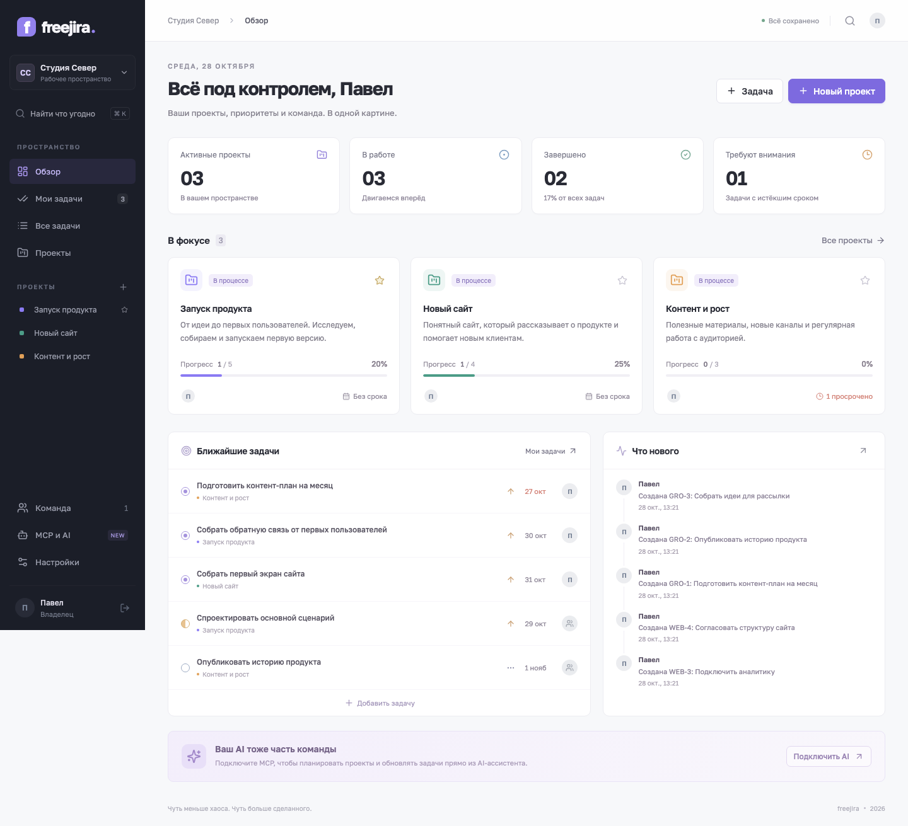
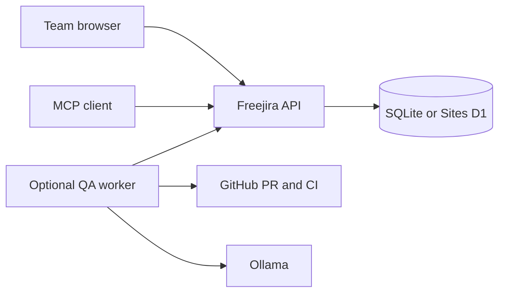

# Freejira

[](https://github.com/a1231231123bc/freejira/actions/workflows/ci.yml) · [MIT](LICENSE) · [Русская документация](README.ru.md)

A shared project workspace for small teams managing several projects at once. Projects, kanban boards, assignments, deadlines, comments and MCP tools use the same source of truth. The interface is currently in Russian.

**Early release · self-hostable · no paid AI API required for core project management.**



_Screenshot uses synthetic demo data from the browser test._

## Choose an edition

|                                  | Self-hosted (repository root)  | [Sites edition](editions/sites/README.md)  |
| -------------------------------- | ------------------------------ | ------------------------------------------ |
| Runtime                          | Node.js 24+, Express, React    | ChatGPT Sites, Vinext, Cloudflare Workers  |
| Storage                          | SQLite on your disk            | D1 database + R2 files                     |
| Identity                         | Local accounts and invitations | ChatGPT sign-in and invitations            |
| MCP                              | HTTP + stdio, personal tokens  | Native Sites MCP + external stdio adapter  |
| Video → tasks                    | Not implemented                | Optional Apple Silicon video processor     |
| Dependencies on hosted platforms | None for core app              | Sites account and platform access required |

These are separate implementations with separate databases. There is no automatic sync or migration between editions. The public repository contains both; the one-command quick start runs the self-hosted edition.

## Quick start

Install **Node.js 24 or newer** and Git, then:

```sh
git clone https://github.com/a1231231123bc/freejira.git
cd freejira
npm ci
npm run build
npm start
```

Open **http://localhost:4173** and create the first owner account. No default password is provided. Data persists in `data/freejira.sqlite`; dependencies and fonts are served locally. For development, run `npm run dev`.

Docker is also supported: `docker compose up -d --build`. The port binds to loopback; a persistent volume stores the database. Configure HTTPS and `PUBLIC_URL` before sharing over the internet. Create the owner before making initial registration public. See [deployment, environment variables, backups and restore](docs/self-hosting.ru.md).

## What is included

- A cross-project overview, personal task list, search, favorites and project archives.
- Kanban and table views; five statuses, priorities, labels, assignees and due dates.
- Team invitations, comments, activity history and optimistic concurrency checks.
- Eleven MCP tools, including task reads, edits, comments and a workspace summary.
- JSON export and a consistent SQLite backup command: `npm run backup`.

One instance serves one team. Every active member can access shared projects. Per-project permissions, email delivery and horizontal scaling are not implemented. Clients refresh shared data every ten seconds and on focus.

## MCP and automatic QA

Create a token in **MCP и AI**. Use `http://localhost:4173/mcp` with `Authorization: Bearer YOUR_FREEJIRA_TOKEN`, or use the [stdio bridge](docs/self-hosting.ru.md#stdio). Keep tokens outside Git. The server requires the current revision for edits and attributes changes to the token owner.

[Freejira QA](https://github.com/a1231231123bc/freejira-qa) is a separate optional worker. It polls tasks in `review`, finds a GitHub PR, runs configured checks and uses Ollama to prepare an evidence-based comment. Install it on an always-on machine to operate independently of your laptop. QA does not automatically close tasks by default.



The Sites edition also includes a video queue, local speech recognition, frame analysis and human review before creating tasks. It requires its own setup; see [video processor](editions/sites/processor/README.md).

## Development

```sh
npm ci
npm run check
npm test
npm run build
npx playwright install chromium
npm run test:ui
```

Tests use temporary databases and synthetic accounts. CI runs API/MCP tests and builds on Node 24 and 26, browser tests on Node 24, plus Sites contract and video processor unit tests. Docker and hosted Sites deployment have separate environment requirements; a green unit test does not prove either deployment works.

| Directory         | Purpose                                                     |
| ----------------- | ----------------------------------------------------------- |
| `src/`            | React interface                                             |
| `server/`         | Express API, authentication, SQLite and MCP                 |
| `shared/`         | Shared TypeScript types                                     |
| `tests/`          | API/MCP and browser scenarios                               |
| `editions/sites/` | Sites application, migrations, video worker and MCP adapter |

See [CONTRIBUTING.md](CONTRIBUTING.md), [SECURITY.md](SECURITY.md), [roadmap](docs/roadmap.md) and [third-party notices](THIRD_PARTY_NOTICES.md).

## License

[MIT](LICENSE). Bundled third-party code retains its original notices. Freejira is an independent project; no affiliation with Atlassian, OpenAI or Anthropic is implied.
